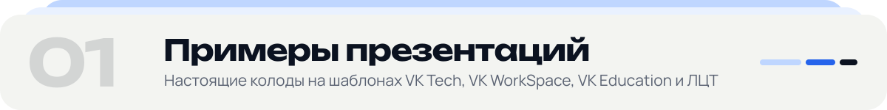
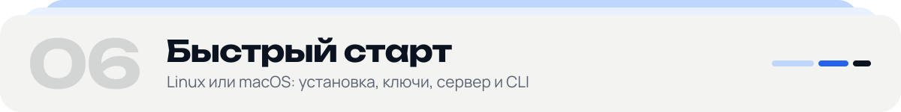
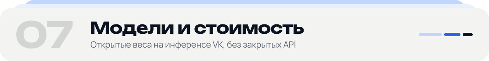
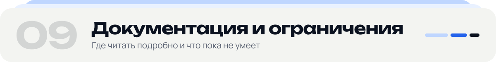

<a id="top"></a>

<p align="center">
  <picture>
    <source media="(prefers-color-scheme: dark)" srcset="docs/readme/svg/hero-dark.svg">
    
  </picture>
</p>

<p align="center">
  <a href=".github/workflows/linux.yml"></a>
  <a href="pyproject.toml"></a>
  <a href="web"></a>
  <a href="MODELS.md"></a>
  <a href="MODELS.md#изображения-внутри-слайдов-t2i"></a>
  <a href="LICENSE"></a>
</p>

**Любой шаблон PowerPoint, текст в любом виде и файлы с данными — на входе; три готовые редактируемые презентации в стиле шаблона и бренда — на выходе.** Агент из открытых моделей решает, какие нужны слайды и о чём каждый; числа считает и сверяет код, а не модель; вёрстка собирается по правилам самого шаблона; каждое решение и каждое число можно открыть и проверить.

Кейс № 4 VK Tech «Цифровой дизайнер презентаций», хакатон «Лидеры цифровой трансформации 2026», команда «Рекрут 2».

<p align="center">
  <a href="#examples"><b>Примеры</b></a> ·
  <a href="#video"><b>Видео</b></a> ·
  <a href="#features"><b>Что умеет</b></a> ·
  <a href="#how"><b>Как работает</b></a> ·
  <a href="#quality"><b>Качество</b></a> ·
  <a href="#start"><b>Быстрый старт</b></a> ·
  <a href="#models"><b>Модели</b></a> ·
  <a href="#tz"><b>ТЗ</b></a> ·
  <a href="#docs"><b>Документация</b></a>
</p>

| Экспертам | Где |
|---|---|
| Скринкаст второй ступени (до 5 минут) | прикладывается в форме сдачи · [раздел «Видео»](#video) |
| Готовые презентации — PDF и PPTX | [Примеры](#examples) · [`examples/showcase`](examples/showcase) |
| Запуск на своей машине: Linux или macOS, около 15 минут; проверка без ключа — 15 секунд | [Быстрый старт](#start) |
| Соответствие ТЗ обеих ступеней по пунктам | [таблица](#tz) |
| Слои и контракты, модели и настройки, все проверки качества | [ARCHITECTURE](ARCHITECTURE.md) · [MODELS](MODELS.md) · [AUDIT](AUDIT.md) |

Постоянного стенда у команды нет: сервис запускается по разделу [«Быстрый старт»](#start), тот же путь на Ubuntu 24.04 проходит CI.

<a id="examples"></a>

<picture>
  <source media="(prefers-color-scheme: dark)" srcset="docs/readme/svg/section-01-examples-dark.svg">
  
</picture>

Каждая колода ниже собрана 20.10 текущей версией с моделью Qwen3.8-27B на инференсе VK — через тот же API, что и интерфейс (незнакомый шаблон — командой `verstka generate`). На карточке — вариант «Структурный», слайды колоды без правок руками; картинки слайдов нарисовал LibreOffice. Нажмите на карточку — откроется PDF всей колоды.

<p align="center">
  <a href="examples/showcase/01-data-brandbook/deck.pdf"></a>
</p>

**01 · Данные + брендбук → история для правления · VK Tech + брендбук VK Cloud.** Вход — бриф в две фразы («Итоги продаж VK Cloud за 9 месяцев 2026 года для правления. Покажи рост выручки, сравни регионы, что даёт выручку и где узкие места»), 7 файлов из [`examples/data-sales-2026`](examples/data-sales-2026) в четырёх форматах (CSV, XLSX, JSON, текст с таблицей) и PDF-гайдлайн [`brandbook-vk-cloud`](examples/brandbook-vk-cloud). Вид каждого слайда выбрал код по профилю данных: ряд из 21 месяца — линия, 8 регионов — ранжированные столбцы, 4 канала с суммой 100 % — кольцо, 512 обращений — гистограмма с выбросами отдельным столбцом, NPS с пропущенными кварталами — линия с разрывами, а не с нулями. Заголовки — выводы с числами, пересчитанными по строкам файлов; бренд победил шаблон — логотип VK Cloud и цвета брендбука на каждом слайде. · [PDF](examples/showcase/01-data-brandbook/deck.pdf) · [бриф](examples/showcase/01-data-brandbook/input.txt) · [тот же вход на шаблоне ЛЦТ, PDF](examples/showcase/01-data-brandbook/deck-lct.pdf) — розовые акценты шаблона уступили синему цвету бренда

<p align="center">
  <a href="examples/showcase/02-data-knowledge/deck.pdf"></a>
</p>

**02 · Таблица + база знаний → отчёт совету · шаблон ЛЦТ 2026.** Вход — план из пяти пунктов («MRR и клиенты: догоняем ли цель года», «отток против цели», «каналы», «деньги: на сколько месяцев хватит», «решения для совета»), книга Excel с показателями и инвестмеморандум DOCX как база знаний. Факт взят из таблицы, цель — из меморандума, и они сведены в одной единице: «MRR 1,82 млн ₽ — 61 % цели 3 млн ₽», «отток 5,2 % — выше цели 3 %» («меньше — лучше»), запас денег — 38 млн ₽ при 4,2 млн ₽ расходов в месяц. · [PDF](examples/showcase/02-data-knowledge/deck.pdf) · [план](examples/showcase/02-data-knowledge/input.txt) · [таблица](examples/showcase/02-data-knowledge/sklad24_q3.xlsx) · [база знаний](examples/showcase/02-data-knowledge/investmemorandum_sklad24.docx)

<p align="center">
  <a href="examples/showcase/03-vk-tech-ml-platform/deck.pdf"></a>
</p>

**03 · Готовый текст → питч продукта · VK Tech.** Вход — 255 слов о запуске прогноза спроса для сети «Город продуктов», модель пишет тексты слайдов, картинки включены. Вышло 15 слайдов: заголовки — выводы с числами («Модель снижает WAPE с 31 % до 18 %»), было/стало — нативной диаграммой, экономика — таблицей, финал — просьба автора «подписать договор до 15 ноября». Две картинки нарисовал Z-Image под палитру шаблона и проверила модель зрения. · [PDF](examples/showcase/03-vk-tech-ml-platform/deck.pdf) · [вход](examples/showcase/03-vk-tech-ml-platform/input.txt)

<p align="center">
  <a href="examples/showcase/04-workspace-migration/deck.pdf"></a>
</p>

**04 · Длинный доклад → колода для конференции · VK WorkSpace.** Вход — доклад ИТ-директора на 611 слов. Агент разложил его на 15 слайдов с тремя разделами, вынес цифры в крупные карточки, «Было / Стало» — по смыслу, а не по словам; тёмный стиль WorkSpace с его хромом и шрифтом сохранён. · [PDF](examples/showcase/04-workspace-migration/deck.pdf) · [вход](examples/showcase/04-workspace-migration/input.txt)

<p align="center">
  <a href="examples/showcase/05-lct-pitch/deck.pdf"></a>
</p>

**05 · Питч на хакатон · шаблон ЛЦТ 2026.** Вход — питч команды на 607 слов. Структура «проблема → решение → результаты → экономика → рынок», процесс — из фигур шаблона, ключевое число — крупно со сравнением («за тот же период прошлого года — 5»). · [PDF](examples/showcase/05-lct-pitch/deck.pdf) · [вход](examples/showcase/05-lct-pitch/input.txt)

<p align="center">
  <a href="examples/showcase/06-education-lesson/deck.pdf"></a>
</p>

**06 · План урока → урок для 7 класса · VK Education.** Вход — план урока информатики на 248 слов. Шаги урока стали этапами, вопрос классу — слайдом с картинкой по смыслу (Z-Image, без надписей — это проверяет модель зрения), итог и домашнее задание — финалом. · [PDF](examples/showcase/06-education-lesson/deck.pdf) · [вход](examples/showcase/06-education-lesson/input.txt)

<p align="center">
  <a href="examples/showcase/07-unseen-template/deck.pdf"></a>
</p>

**07 · Незнакомый шаблон.** Шаблон «Vivid» из LibreOffice, под который ничего не настраивалось, и бизнес-план на 1 205 слов из [`examples/briefs`](examples/briefs/fitness_studio.md). Шаблон набран стандартными шрифтами, поэтому Verstka подобрала пару по его характеру («строгий деловой» — IBM Plex Sans) и встроила её в PPTX; цифры автора стали нативными диаграммами: круговой, столбцами, линиями. · [PDF](examples/showcase/07-unseen-template/deck.pdf) · [PPTX](examples/showcase/07-unseen-template/deck.pptx)

<details>
<summary><b>Ещё примеры в репозитории</b></summary>

- [`examples/data-sales-2026`](examples/data-sales-2026) — 7 файлов продаж в 4 форматах, ожидаемые виды — в `SCENARIO.md`; [`examples/data-science-2026`](examples/data-science-2026) — 6 файлов другой природы; [`examples/brandbook-vk-cloud`](examples/brandbook-vk-cloud) — условный брендбук: PDF, токены, логотипы.
- [`examples/outputs`](examples/outputs) — 9 демо-презентаций первой ступени (один текст × три шаблона VK × три варианта), собраны 29.09, до доводки второй ступени.
- [`examples/improve`](examples/improve) — готовая презентация для «Улучшить готовую»; [`examples/briefs`](examples/briefs) — брифы; [`tests/fixtures/plans`](tests/fixtures/plans) — планы экспертов в разных формах.

</details>

<a id="video"></a>

<picture>
  <source media="(prefers-color-scheme: dark)" srcset="docs/readme/svg/section-02-video-dark.svg">
  
</picture>

<p align="center">
  <a href="https://cdn.jsdelivr.net/gh/hl0pch1k/verstka@21c4283/docs/video/verstka-demo.mp4"><picture><source media="(prefers-color-scheme: dark)" srcset="docs/readme/svg/video-stage1-dark.svg"></picture></a>
  <picture><source media="(prefers-color-scheme: dark)" srcset="docs/readme/svg/video-stage2-dark.svg"></picture>
</p>

- **Первая ступень** — [смотреть в браузере](https://cdn.jsdelivr.net/gh/hl0pch1k/verstka@21c4283/docs/video/verstka-demo.mp4) · [файл `verstka-demo.mp4`](docs/video/verstka-demo.mp4) · [что в видео по минутам](docs/video/README.md). Запись живого сервиса в Chrome: шаблон VK Tech, затем незнакомый шаблон с SlidesCarnival, замечания и их исправление, правка словами. Записано 29.09 на интерфейсе до «Слоёв».
- **Вторая ступень** — скринкаст до 5 минут на интерфейсе «Слои» (данные, брендбук, база знаний) прикладывается в форме сдачи второй ступени; ссылка появится здесь.

<p align="center">
  
</p>

Агент работает на виду: аналитик читает вход, дизайнер продумывает каждый слайд, критик проверяет план; вёрстка, проверка качества и «Взгляд дизайнера» — в реальном времени.

<a id="features"></a><a id="что-умеет"></a>

<picture>
  <source media="(prefers-color-scheme: dark)" srcset="docs/readme/svg/section-03-features-dark.svg">
  
</picture>

<p align="center">
  <picture>
    <source media="(prefers-color-scheme: dark)" srcset="docs/readme/svg/features-dark.svg">
    
  </picture>
</p>

<a id="вторая-ступень-данные-и-брендбук"></a>

#### Данные → выводы (вторая ступень)

Код ([`verstka/data/`](verstka/data)) читает CSV, TSV, XLSX, JSON и текст с таблицей и строит **профиль**: типы и роли колонок, ось времени, единицы, пропуски, выбросы. По профилю и вопросу брифа он выбирает **аналитическую задачу** (динамика, сравнение, доли, распределение, ключевые значения…) и **2–3 вида визуализации из 14 с причинами** — «почему не он» видно в «Почему так». Заголовок — **вывод с настоящим числом** («Выручка выросла на 23% к сентябрю»), а не тема.

- **Вопросы плана → нужная метрика**: «сравни регионы» — ранжированные столбцы, «рост сегментов» — изменение между срезами, воронка — конверсия этапов, затраты — на одного клиента; цены не складываются.
- **План и факт**, цель и норма — в одной единице; «меньше — лучше» у времени, затрат и ошибок; итог берётся за **последний период**.
- **Большие данные агрегируются**: ряд — к периодам, категорий больше 12 — топ и «Остальные N», справочник — топ-10 строк.
- Каждое число и утверждение («впереди», «растёт быстрее всех», «в K из N») **пересчитывается по сырым строкам файла** до показа ([`verify.py`](verstka/data/verify.py)); не подтвердилось — слайд получает описание вместо вывода. Вопрос, на который данные не отвечают, честно попадает в **«Чего нет в данных»**.
- Слайд с данными — **нативная диаграмма или таблица PowerPoint** в стиле шаблона, подписи осей с единицами, «Источник: файл». Одинаковые данные в CSV, XLSX и JSON дают один и тот же вид на любом шаблоне.

#### Брендбук в любой форме

PDF-гайдлайн, токены JSON (W3C и экспорт Tokens Studio), ссылка Figma (с `FIGMA_TOKEN`), **файл `.fig` без Figma и без токена**, PPTX/POTX, логотип SVG/PNG, папка или ZIP ([`verstka/brand/`](verstka/brand)). Брендбук применяется к копии шаблона — цвета с защитой контраста, шрифты, логотип, поля; при расхождении **по умолчанию побеждает бренд**, переключатель «Шаблон» оставляет шаблон как есть. Монохромный бренд получает акценты тонами основного цвета.

#### База знаний

Документы по одному, папкой или ZIP и ссылки на публичные страницы: локальный поиск (BM25, ничего не уходит наружу), цифры — только из документов, источник каждого утверждения — в заметках слайда ([`verstka/knowledge/`](verstka/knowledge)). Вместе с таблицами база знаний даёт цели и нормы, а **числа таблиц важнее чисел из документов**.

#### Любой вход

- **План в любой форме**: «Слайд N. …», нумерованный список, маркеры, письмо коллеге, тезисы; пункт — слайд в порядке автора, указания «покажи на графике» — форма слайда, а не текст.
- **DOCX и PDF** (также `.txt`, `.md`, HTML, через LibreOffice — `.doc`, `.rtf`, `.odt`); длинный документ — стенограмма, отчёт — сжимается в 10–15 слайдов выводов.
- **Короткая тема** («Сделай презентацию про интегралы») — текст пишет агент по статье Википедии или по базе знаний; формулы — настоящие Office Math.
- **Дословный режим** — при выключенном «Модель пишет тексты» текст автора раскладывается как написан, без пересказа.
- **Готовая презентация** — «Улучшить готовую»: текст читается обратно, вёрстка собирается заново.

#### Картинки по смыслу

Z-Image (открытые веса, ≈ 10B) рисует там, где автор описал место или заголовок называет видимый предмет — полосой у края слайда, в палитре шаблона. Готовую картинку смотрит модель зрения: надпись или её подобие — картинка рисуется заново, до трёх попыток.

#### Правки и Помощник

«Исправить слайд» правит замечание на месте по замеру (контраст, мелкий текст, наезд) или отдаёт слайд дизайнеру. В поле правок и в **Помощнике**: «переделай полностью», «покажи таблицей», «крупнее цифры», «короче», «итог Q3 к Q2 в процентах, выдели падение», «почему слайд 4 такой», «верни как было». Без модели те же правки выполняют правила, и ответ говорит, что сделано по правилам.

<a id="как-это-выглядит"></a>

<p align="center">
  
</p>

<details>
<summary><b>Ещё экраны «Слоёв»: создание, замечания, Помощник, «Почему так», разбор шаблона, паспорт запуска</b></summary>


</details>

Интерфейс «Слои» — React + TypeScript, для компьютера: раскладка рассчитана на 1280 × 900, в окне меньше сцена уменьшается целиком; проверен в Chrome и Safari.

<a id="how"></a><a id="как-устроено"></a>

<picture>
  <source media="(prefers-color-scheme: dark)" srcset="docs/readme/svg/section-04-how-dark.svg">
  
</picture>

<p align="center">
  <picture>
    <source media="(prefers-color-scheme: dark)" srcset="docs/readme/svg/pipeline-dark.svg">
    
  </picture>
</p>

1. **Чтение.** Шаблон разбирается один раз в `manifest.json` — палитра с ролями цветов, шкала кеглей, сетка и поля, хром, карточки, типы слайдов-образцов (голосуют эвристики, текстовая модель и модель зрения) — и кэшируется по хэшу. Вход любого вида сводится к тексту колоды; файлы с данными — к профилю; брендбук — к `BrandSpec`.
2. **План.** Агент — аналитик, дизайнер на каждый слайд, критик — строит `outline.json`: какие слайды, о чём каждый, какая форма.
3. **Смысл.** Компилятор сверяет каждое число и пропорцию («6 из 30», «вдвое», доли) со входом; не сошлось — остаются слова автора.
4. **Данные.** Код считает, модель понимает цели брифа над настоящими колонками (`goal_reader`) и пишет связку колоды (`data_storyteller`); вид диаграммы она не выбирает и чисел не считает.
5. **Вёрстка.** Подбор макета объяснимо ставит слайд на образец шаблона; вёрстка клонирует образец или компонует слайд из фигур шаблона, меряя текст метриками шрифта.
6. **Картинки** — по смыслу слайда, без надписей, в палитре.
7. **Аудит.** 73 детерминированные и 3 модельные проверки, автоисправление с откатом ухудшений, «Взгляд дизайнера» пересобирает неудачные слайды. Замечания и просьбы из чата возвращаются к агенту — он переделывает только нужный слайд с той же сверкой чисел.
8. **Экспорт** — PPTX с нативными диаграммами, таблицами и формулами, PDF и HTML; шрифты встроены.

Промпты и параметры — отдельными версионированными файлами ([`skills/`](skills), [`agents/`](agents), [`configs/`](configs)); версии и sha256 скиллов, модель, которая ответила, и время по этапам каждого запуска — в `run_manifest.json`. Без модели каждый шаг заменяется детерминированным, и это записывается.

```
verstka/   ingest · analysis (шаблон) · planning (агент, план, смысл, писатель)
           knowledge (база знаний) · data, brand (вторая ступень) · matching
           rendering · audit · export · images · api · providers · fonts
skills/  agents/  configs/   промпты, агенты, модели, стратегии
web/       интерфейс «Слои»: React + TypeScript + Vite
examples/  брифы, данные, брендбук VK Cloud, демо-презентации, витрина showcase
tests/     модульные и интеграционные тесты, фикстуры: шаблоны, планы, документы, база знаний
```

<a id="quality"></a>

<picture>
  <source media="(prefers-color-scheme: dark)" srcset="docs/readme/svg/section-05-quality-dark.svg">
  
</picture>

<p align="center">
  <picture>
    <source media="(prefers-color-scheme: dark)" srcset="docs/readme/svg/quality-dark.svg">
    
  </picture>
</p>

| Что | Как |
|---|---|
| **Проверки** | **76** в реестре: 73 детерминированные (вёрстка, шаблон, плотность, целостность, содержание, графики и слайды с данными) и 3 модельные — «Взгляд дизайнера», 11 вопросов Приложения 1, связность колоды. Модельные включены по умолчанию, когда подключена модель. `verstka checks` печатает реестр, разбор — [AUDIT.md](AUDIT.md) |
| **Автоисправление** | перевыбор макета, правка текста, до двух итераций; итерация, после которой стало хуже, откатывается. Замечания — рамками прямо на слайде |
| **Сверка чисел** | каждое число и пропорция — со входом до вёрстки и в готовом PPTX; числа с данными — по сырым строкам файла |
| **Время** | до 5 минут на три варианта. Колоды с данными в последнем прогоне жюри — 26–80 с на колоду; колоды витрины с моделью, «Взглядом дизайнера» и картинками — 3,3–3,7 мин при четырёх сборках одновременно; без модели — 5–20 с |
| **Тесты** | 5 294 модульных · 48 интеграционных (полный пайплайн на шаблонах VK, ЛЦТ и колоде без макетов) · 756 тестов интерфейса. Тесты не ходят в сеть: модели заменяет `MockProvider` |
| **CI** | Ubuntu 24.04 ([`linux.yml`](.github/workflows/linux.yml)) на каждую отправку в `main`, `next` и `data-stage2` повторяет быстрый старт: установка, проверка без ключа, веб-сервис, модульные тесты и тесты интерфейса |

Рядом с каждой колодой: `outline.json` (план и реестр фактов), `layout_plan.json` (выбор макета с причинами), `audit_report.json` (замечания, исправления, сверка чисел), `run_manifest.json` (версии и хэши скиллов, модель, время по этапам, git-коммит).

<a id="start"></a><a id="запуск"></a>

<picture>
  <source media="(prefers-color-scheme: dark)" srcset="docs/readme/svg/section-06-start-dark.svg">
  
</picture>

Сервис — один процесс `verstka serve` (веб-интерфейс и API); модели подключаются по API, GPU не нужен. Команды — для Ubuntu 24.04 и macOS; на Windows — внутри WSL 2 с Ubuntu.

**1. Системные программы** — Python 3.11 или 3.12, LibreOffice (картинки слайдов и PDF), poppler (`pdftoppm`), Node.js 20+ (один раз собрать интерфейс), git.

```bash
# Ubuntu 24.04 (Node.js 20 — из NodeSource: в стандартном репозитории 18)
sudo apt-get update && sudo apt-get install -y git python3-venv python3-pip libreoffice-impress poppler-utils
curl -fsSL https://deb.nodesource.com/setup_20.x | sudo -E bash - && sudo apt-get install -y nodejs

# macOS (Homebrew)
brew install python@3.11 node poppler git && brew install --cask libreoffice
```

**2. Код и зависимости**

```bash
git clone https://github.com/hl0pch1k/verstka.git && cd verstka
python3 -m venv .venv            # на macOS: python3.11 -m venv .venv
source .venv/bin/activate        # в каждом новом окне терминала
pip install --upgrade pip && pip install -e ".[api,dev]"
cd web && npm install && npm run build && cd ..
cp verstka/fonts/Play-*.ttf ~/Library/Fonts/   # только macOS: шрифт шаблонов VK для превью LibreOffice
```

**3. Проверка без ключа и без сети — около 15 секунд**

```bash
verstka generate -t tests/fixtures/tpl_audit/templates/lo_focus.pptx -b examples/briefs/fitness_studio.md -o out/check --no-llm --no-vlm --export all
```

В `out/check/` — три варианта (`structured`, `visual`, `compact`), в каждом `deck.pptx`, `deck.pdf`, `deck.html` и отчёты; в консоли — план и оценка проверки.

**4. Ключи моделей.** `cp .env.example .env` и впишите значения — в `.env` нужны только эти имена, сам файл в git не попадает:

```
VK_INFERENCE_API_KEY=     # инференс VK: с обоими ключами VK профиль configs/models.vk.yaml включается сам
VK_PROJECT_ID=
POLZA_API_KEY=            # Polza.ai: картинки Z-Image и запасной путь, если VK не отвечает; без ключей VK — все модели
```

Проверка, что модель отвечает:

```bash
verstka generate -t tests/fixtures/tpl_audit/templates/lo_focus.pptx -b examples/briefs/fitness_studio.md -o out/model_check
python -c "import json; p = json.load(open('out/model_check/structured/run_manifest.json'))['planner']; print(p['planned_by'], p.get('model'))"
```

`agent …` — план составила модель (какая ответила — в `run_manifest.json`); `rules None` — модель недоступна, колода собрана без неё, причина — в консоли.

**5. Веб-интерфейс**

```bash
verstka serve                    # http://127.0.0.1:8000, API — http://127.0.0.1:8000/docs
```

Шаблоны датасета кейса (VK Tech, VK Education, VK WorkSpace) в репозиторий не входят: загрузите их кнопкой «Загрузить свой» или положите папку `Датасет` рядом с репозиторием (`../Датасет`). Порт занят — `--port 8080`; доступ из своей сети — `--host 0.0.0.0` (авторизации нет, только доверенная сеть).

<a id="как-проверить"></a>

**6. CLI на каждый вид входа** — без ключа и сети (`--no-llm --no-vlm`) за 5–20 секунд; уберите эти флаги, чтобы работала модель.

```bash
T=tests/fixtures/tpl_audit/templates/lo_focus.pptx     # незнакомый шаблон LibreOffice из репозитория
verstka generate -t $T -b tests/fixtures/plans/warehouse_email.md -o out/plan --no-llm --no-vlm          # план письмом
verstka generate -t $T -b tests/fixtures/documents/report.docx -o out/docx --no-llm --no-vlm             # документ DOCX (или .pdf)
echo "Сделай презентацию о результатах третьего квартала для правления" > brief.md
verstka generate -t $T -b brief.md --kb tests/fixtures/documents/kb -o out/kb --no-llm --no-vlm          # тема + база знаний
verstka generate -t $T --data examples/data-sales-2026 --brand examples/brandbook-vk-cloud/guideline.pdf \
  -o out/data --no-llm --no-vlm                                                                         # данные + брендбук
verstka generate -t $T -b examples/briefs/fitness_studio.md -o out/plain --no-llm --no-vlm --no-pick-fonts  # шрифты шаблона как есть
```

Ещё команды: `verstka analyze <шаблон>` (разбор и `gallery.html`), `verstka audit <deck.pptx> -t <шаблон>` (проверка любой колоды), `verstka kb <документы и ссылки>` (база знаний), `verstka generate --config configs/run.example.yaml` (запуск одним конфигом), `verstka checks` и `verstka skills` (реестры).

**Тесты**

```bash
pytest tests/unit            # модульные; тесты на шаблонах VK и ЛЦТ пропускаются, если шаблонов нет
pytest tests/integration     # интеграционные: полный пайплайн на шаблонах VK, ЛЦТ и колоде без макетов (нужен датасет)
cd web && npm test           # тесты интерфейса
```

<details>
<summary><b>Переменные окружения</b></summary>

| Переменная | Что задаёт | По умолчанию |
|---|---|---|
| `VK_INFERENCE_API_KEY`, `VK_PROJECT_ID` | инференс VK: при обоих включается профиль `configs/models.vk.yaml` | профиль Polza |
| `POLZA_API_KEY` | Polza.ai: Qwen3.8-27B, Qwen3.6-27B, Z-Image; с ключами VK — запасной путь и картинки | без моделей, места под картинки свободны |
| `VERSTKA_MODELS` | принудительно выбрать профиль (`configs/models.vk.yaml` или `configs/models.yaml`), важнее ключей VK | по ключам |
| `VK_T2I_MODEL` | собственная модель изображений VK, если появится; Z-Image отвечает после неё | Z-Image на Polza |
| `VERSTKA_WORKSPACE` | кэш шаблонов, генераций, данных, брендбуков, баз знаний | `./workspace` |
| `FIGMA_TOKEN` | брендбук по ссылке Figma | ссылка Figma не читается |
| `VERSTKA_WIKI`, `VERSTKA_WRITER` | `0` — писатель по теме без Википедии / выключен | включены |
| `VERSTKA_MAX_*_MB` | пределы загрузки: `UPLOAD` (шаблон), `DATA`, `XLSX`, `TEXT`, `BRAND`, `DOC`, `KB_UPLOAD` | 200, 25, 4, 15, 50, 25, 100 |
| `VERSTKA_SOFFICE` | путь к LibreOffice в нестандартном месте | поиск в `PATH`, приложении macOS, `/opt/libreofficeX.Y` |
| `VERSTKA_CORS_ORIGINS` | адреса для API из другого источника | сервер разработки Vite |

</details>

<a id="models"></a>

<picture>
  <source media="(prefers-color-scheme: dark)" srcset="docs/readme/svg/section-07-models-dark.svg">
  
</picture>

| Роль | Модель | Где | Стоимость |
|---|---|---|---|
| Текст, план, проверки, зрение | **Qwen3.8-27B** (Apache 2.0, 27,8B) | инференс VK — спрашивается первым (`qwen38-27b-fp8`) | VK стоимость не сообщает — в `run_manifest.json` поле пустое |
| Запасной путь | Qwen3.8-27B → Qwen3.6-27B | Polza, если VK не ответил, в том же запросе | по замерам 20.10 — 4–11 ₽ за три варианта вместе с проверками моделью |
| Картинки | **Z-Image** (Apache 2.0, ≈ 10B) | Polza (у инференса VK модели изображений нет) | 1,40 ₽ за картинку |

Закрытых API нет. Без ключей сервис работает целиком без моделей: разбор шаблона, план по структуре текста, детерминированная проверка. Все колоды витрины построила модель на инференсе VK. Роли, промпты и настройки — [MODELS.md](MODELS.md), профили — [`configs/models.vk.yaml`](configs/models.vk.yaml) и [`configs/models.yaml`](configs/models.yaml).

<a id="tz"></a><a id="соответствие-тз"></a>

<picture>
  <source media="(prefers-color-scheme: dark)" srcset="docs/readme/svg/section-08-tz-dark.svg">
  
</picture>

✅ — сделано, ◐ — частично.

| Требование | | Как сделано |
|---|:-:|---|
| Парсинг шаблона, токены, паттерны, правила | ✅ | [`analysis/`](verstka/analysis) → `manifest.json`, «Подробнее» → «Шаблон»; любой шаблон, в том числе без макетов |
| Структура и текст по брифу и назначению | ✅ | агент [`planning/`](verstka/planning); вход в любом виде; свой текст дословно при выключенном «Модель пишет тексты» |
| Слайды в контексте шаблона и контент-пакета | ✅ | слайды-образцы шаблона, композиция из его фигур, иконки и иллюстрации шаблона |
| Графики, таблицы, диаграммы, аналог SmartArt | ✅ | нативные диаграммы 12 типов, таблицы, крупные цифры, этапы и процессы из фигур, формулы |
| Генерация изображений (звёздочка) | ✅ | Z-Image (Apache 2.0, ≈ 10B ≤ 20B), без надписей, в палитре шаблона |
| Версионирование скиллов и агентов | ✅ | `skills/<имя>/skill.yaml` с версией и sha256, `run_manifest.json` |
| Три варианта с обоснованной осью различий | ✅ | структурный, визуальный, компактный ([`strategies.yaml`](configs/strategies.yaml)) |
| Аудит с визуализацией и выбором исправлений | ✅ | 73 + 3 проверки, замечания на слайде, «Исправить слайд» |
| Экспорт PPTX (нативные объекты), PDF, HTML | ✅ | [`export/`](verstka/export); шрифты встроены в PPTX и HTML |
| 10–15 слайдов или заданное число; ≤ 5 минут | ✅ | число из текста (и диапазоном) или параметра; обычно 1–4 мин с моделью, 5–20 с без неё |
| Не заточено под три шаблона | ✅ | правила — по геометрии, пикселям и данным шаблона; прогоны на 14 незнакомых шаблонах LibreOffice и шаблоне ЛЦТ, охранный тест [`test_unseen_templates_guard.py`](tests/unit/test_unseen_templates_guard.py) |
| Десктопный веб | ✅ | интерфейс «Слои», окно меньше 1280 × 900 — сцена уменьшается целиком |
| Chrome, Firefox, Safari, Яндекс Браузер | ◐ | проверено в Chrome и Safari; Firefox и Яндекс Браузер не проверялись (только стандартные веб-API) |
| Открытые веса Apache 2.0 / MIT, ≤ 35B, инференс VK | ✅ | Qwen3.8-27B на инференсе VK первой, Polza — при недоступности VK; закрытых API нет |
| Профилирование данных, задача, 2–3 вида с причинами | ✅ | [`profile.py`](verstka/data/profile.py), [`task.py`](verstka/data/task.py), [`viz.py`](verstka/data/viz.py); «Почему так» |
| Заголовки-выводы, оси, единицы, источник | ✅ | [`headline.py`](verstka/data/headline.py), число пересчитано по сырым строкам ([`verify.py`](verstka/data/verify.py)) |
| Агрегация больших данных; нетипизируемые — сообщение | ✅ | [`aggregate.py`](verstka/data/aggregate.py); «Не для графика: одни текстовые колонки» |
| Брендбук важнее шаблона, если не выбрано иное | ✅ | [`brand/`](verstka/brand): брендированная копия шаблона, переключатель приоритета, расхождения |
| Нет жёсткого «формат → график», один вид на любом шаблоне | ✅ | выбор по профилю и целям; одинаковые данные в CSV, XLSX и JSON дают один выбор (тесты) |
| 5–7 наборов данных, примеры брендбуков | ✅ | 13 файлов в двух наборах, брендбук VK Cloud в нескольких форматах |
| README, ARCHITECTURE, MODELS, AUDIT; промпты и конфиги отдельно | ✅ | этот файл, [ARCHITECTURE](ARCHITECTURE.md), [MODELS](MODELS.md), [AUDIT](AUDIT.md), `skills/`, `configs/` |

<a id="docs"></a>

<picture>
  <source media="(prefers-color-scheme: dark)" srcset="docs/readme/svg/section-09-docs-dark.svg">
  
</picture>

**Документация.** [ARCHITECTURE.md](ARCHITECTURE.md) — слои, контракты, данные и брендбук · [MODELS.md](MODELS.md) — модели, роли, расход · [AUDIT.md](AUDIT.md) — все проверки и тесты · [docs/video](docs/video/README.md) — видео первой ступени · [питч первой ступени, PDF](docs/presentation/verstka-pitch.pdf) · графика этого README собирается скриптами [`docs/readme/source`](docs/readme/source) из шрифтов интерфейса.

**Ограничения — честно.**

- Интерфейс — только для компьютера; Firefox и Яндекс Браузер не проверялись.
- Текст по короткой теме пишет модель: проверка по статье или базе знаний отбрасывает неподтверждённое, но может пропустить ошибку — результат помечен «Текст писал агент» с источником.
- Без модели формулировки проще: заголовки-выводы — из предложений самого текста, цели данных разбирают правила.
- Данные: вид выбирает код из 14; таблица на слайде — до 10 строк; не читаются `.xls`, `.xlsb`, `.ods`, `.numbers`; сложные вопросы (вторая часть двухчастного вопроса, взвешенное среднее) колода может оставить без ответа и говорит об этом. Три варианта колоды с данными различаются вёрсткой, текст у них общий.
- Брендбук: PDF-скан без текста читается только моделью; ссылка Figma — через REST API с `FIGMA_TOKEN`, проверена на подставленных ответах API.
- Картинки рисует Z-Image на Polza, поэтому для них нужен `POLZA_API_KEY`.
- Превью и PDF рисует LibreOffice: шрифт, которого нет в системе и в файле, заменяется. SmartArt, видео и анимации шаблона не разбираются.
- Хранилище файловое, очередь задач — в процессе: сервис рассчитан на одного или нескольких пользователей. Разработка шла на macOS; Linux проверяется в CI.

Лицензия — MIT ([`LICENSE`](LICENSE)). Шрифты в [`verstka/fonts/`](verstka/fonts) — SIL OFL 1.1, лицензия рядом с каждым семейством.

<p align="right"><a href="#top">↑ наверх</a></p>
